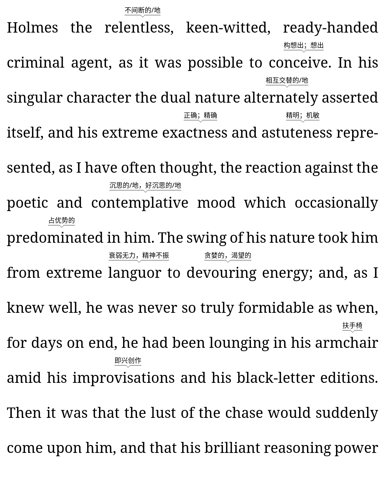

# Word Wise (KOReader plugin)

Shows short inline definitions above difficult words, like Kindle's Word Wise —
painted as a per-page overlay on the book you're reading (no copy, no file
rewrite). Difficulty is adjustable: a low hint level shows only rare/hard words,
a high one also glosses more common ones.



## Install

1. `git clone` this repo, or use the green **Code → Download ZIP** button and
   unzip it. A ZIP download unzips as **`wordwise.koplugin-main`** — remove the
   `-main` so the folder ends in `.koplugin`, or KOReader won't recognize it
   (cloning already gives the right name).
2. Copy the `wordwise.koplugin` folder into KOReader's `koreader/plugins/`
   directory on your Android device.
3. Put a dictionary file named `wordwise.db` into that folder (see
   *Dictionary* below).
4. Restart KOReader.

## Activate

Open a book, then: **☰ (or ⋮) → more tools → Word Wise → Show inline hints**.
Pick a hint level (1 = only the rarest words … 5 = most hints). Short definitions
then appear above difficult words on every page. Turn it off from the same menu.

## Dictionary (not included)

The plugin does **not** ship a dictionary — you supply your own `wordwise.db`.

### Where the dictionary lives

There is exactly one location: `wordwise.db` inside the plugin folder
(`koreader/plugins/wordwise.koplugin/wordwise.db`). If it is missing,
**Show inline hints** tells you this path when you turn it on.

### Canonical schema

`wordwise.db` is an SQLite database; the plugin reads exactly this shape:

```sql
CREATE TABLE entries (
    word       TEXT PRIMARY KEY COLLATE NOCASE,
    short_def  TEXT NOT NULL,      -- the gloss shown above the word
    difficulty INTEGER NOT NULL,   -- 1 rarest .. 5 most common
    pos        TEXT                -- part of speech (optional)
);
```

A word is glossed when `difficulty <= hint level`. Lookups fall back to a few
cheap English de-inflections (plurals, `-ed`, `-ing`, `-ly`) so inflected forms
in the text still match base-form entries.
